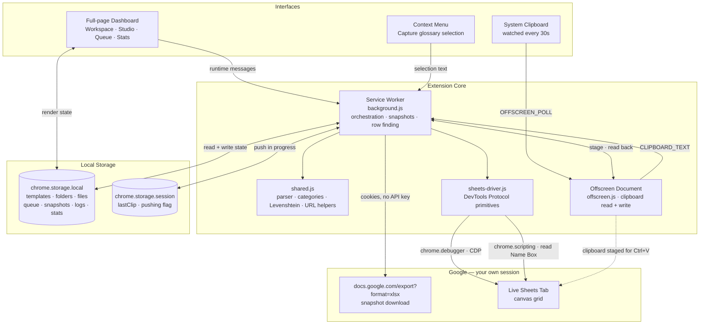
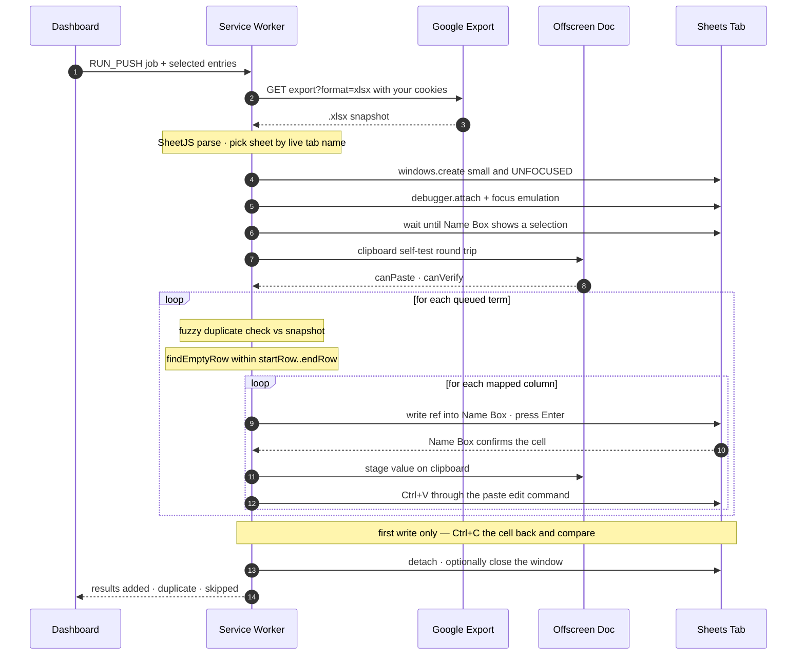
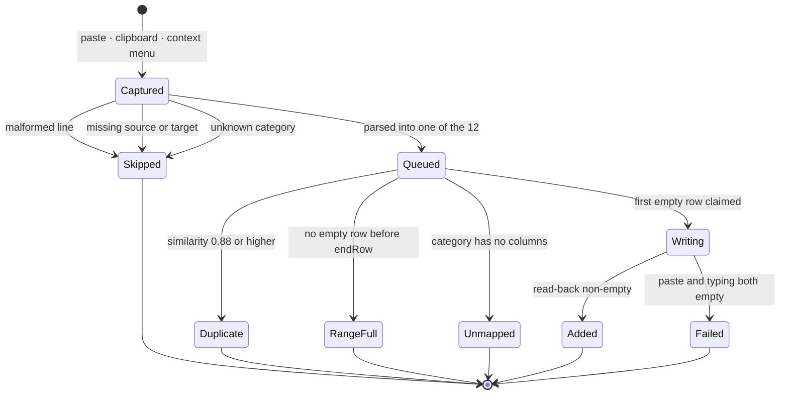

# 📘 Smart Glossary Filler

<p align="center">
  
  <br>
  <b>Smart Glossary Filler</b> — Glossary Capture &amp; Google Sheets Automation Engine for Translation Teams
</p>

<p align="center">
  
  
  
  
  
  <br>
  
  
  
  
  
</p>

**Smart Glossary Filler** is a Manifest V3 Chrome extension that turns a block of glossary
text into filled rows of a live Google Sheet. It parses terms into 12 fixed categories, maps
each category to its own column group and row range, rejects fuzzy duplicates against the
sheet's current contents, finds the first genuinely empty row, and writes the values by
driving the real page — a Name Box jump and a true <kbd>Ctrl</kbd>+<kbd>V</kbd>.

There is no server, no OAuth app, no API key and no telemetry. Sheets are read through the
Google session already in your browser, and written the way a person would write them.

---

## 📑 Table of Contents

- [Why This Exists](#-why-this-exists)
- [Key Features](#-key-features)
- [Screenshots](#-screenshots)
- [System Architecture](#-system-architecture)
- [How a Push Works](#-how-a-push-works)
- [Term Lifecycle](#-term-lifecycle)
- [Tech Stack](#-tech-stack)
- [Prerequisites](#-prerequisites)
- [Quick Start](#-quick-start)
- [Glossary Text Format](#-glossary-text-format)
- [The 12 Categories](#-the-12-categories)
- [Column Mapping](#-column-mapping)
- [The Dashboard](#-the-dashboard)
- [Duplicate Detection](#-duplicate-detection)
- [Empty-Row Selection](#-empty-row-selection)
- [Permissions](#-permissions)
- [Data, Privacy and Storage](#-data-privacy-and-storage)
- [Export and Import](#-export-and-import)
- [Project Structure](#-project-structure)
- [Troubleshooting](#-troubleshooting)
- [Known Limitations](#-known-limitations)
- [Development](#-development)
- [License](#-license)

---

## 🎯 Why This Exists

Translating serialised fiction means maintaining a glossary: every character name, sect,
skill and honorific has to land in a spreadsheet, in the right column group, without
duplicates. Doing that by hand for a few hundred terms per volume is slow and error-prone.

The hard part is **writing** into Google Sheets:

| Obstacle | Why the obvious approach fails |
| :--- | :--- |
| The grid is a `<canvas>` | There is no cell element to set a value on. |
| Synthetic clipboard events | A `ClipboardEvent` built in JavaScript carries no user gesture, so Sheets drops it. |
| The Sheets API | Needs an OAuth app, a client secret, consent screens and quota — for a personal tool. |

So this extension splits the problem in two:

- **Reading** — downloads the sheet as an `.xlsx` snapshot through your existing Google
  session and analyses it offline with SheetJS. That is how it knows which rows are empty
  and which terms already exist, with zero API quota.
- **Writing** — drives the live page through the Chrome DevTools Protocol: write the cell
  reference into the Name Box, press a genuine <kbd>Enter</kbd>, stage the value on the
  clipboard, press a genuine <kbd>Ctrl</kbd>+<kbd>V</kbd>. Sheets performs the paste itself.

---

## 🌟 Key Features

### 📝 1. Strict Glossary Parser
- **One fixed line grammar** — `* Category: - [KR] "Source" → "Target (Notes)"` — with tolerant
  input: `→ ⇒ -> =>` arrows, `- – — • *` bullets, straight or curly quotes, optional labels.
- **Markdown-aware:** `**bold**` and `__italics__` are stripped before matching, so LLM output
  pastes verbatim, and `**12. Other Terms**` headings set the category for the block beneath.
- **Alias resolution:** singular, plural, numbered or shorthand labels all fold onto the 12
  canonical categories — `Term`, `Org Name`, `System/Level Term`, `SFX`, `Clan`, `Realm`.
- **Missing-pair rule:** a line with a source but no target — or the reverse — is *never*
  queued. It is skipped and the reason is logged. A half-entry is worse than no entry.
- **Prose immunity:** a heading only switches the category when it genuinely names one of the
  12, so narrative text between blocks cannot hijack the lines that follow.

### 🗂 2. Templates, Folders and Per-File Overrides
- **Template Studio:** describe a sheet layout once — 12 categories × 5 fields — and reuse it
  across every file. Templates carry an optional logo image.
- **Colour-accurate preview:** the fetched `.xlsx` renders as an HTML table with its original
  fill colours, font weights and alignment, read from SheetJS cell styles.
- **Click-to-map:** click a mapping box, then click a cell in the preview. Mapped cells are
  outlined live in the grid.
- **Nested workspace:** folders inside folders, file tiles with logos, bound accounts and
  custom links (wiki, raws, comic).
- **Override, don't fork:** a file stores only the fields that differ from its template;
  inherited values show greyed as placeholders.

### ✍️ 3. Real Paste Writer with Self-Verification
- **Genuine <kbd>Ctrl</kbd>+<kbd>V</kbd>** via `Input.dispatchKeyEvent` with `commands: ["paste"]`,
  which invokes the renderer's own edit command — no hidden input to locate, no private class
  names to depend on.
- **Keystroke fallback:** `Input.insertText`, then per-character `char` events, used
  automatically if paste is unavailable.
- **Read-back verification:** the first write of every push is copied back off the grid with
  <kbd>Ctrl</kbd>+<kbd>C</kbd> and compared. Reformatted values pass; an empty cell triggers
  the fallback and, failing that, a precise error.
- **Clipboard self-test** runs first, so an unreadable clipboard can never be mistaken for an
  empty cell.
- **Non-stealing window:** the sheet opens small and **unfocused** with
  `Emulation.setFocusEmulationEnabled`, so a push never grabs your keyboard or mouse.
- **Never claims an unobservable write.** This is the core design rule.

### 🧮 4. Fuzzy Duplicate Prevention
- **Normalised Levenshtein similarity** at a **0.88** threshold, compared against both the
  source and target columns of the live snapshot.
- Normalisation drops case, whitespace, quotes and punctuation, so `"Kim Cheol-su"` and
  `kim cheolsu` collide as intended.
- In-batch awareness: a term appearing twice in one paste is written once.

### 📐 5. Boundary-Aware Row Placement
- Finds the first row where **every** mapped column is blank, from `startRow` onward.
- Honours an optional `endRow` per category, so several categories share one sheet in
  side-by-side column groups, each with its own vertical range.
- Rows claimed earlier in the same push are never reused.

### 📋 6. Capture From Anywhere
- Paste box in the dashboard, with a live added/skipped count.
- **Clipboard watcher** — polls every 30 s and captures anything matching the glossary
  pattern, automatically paused during a push.
- **Right-click → Capture glossary selection** on any page.

### 📊 7. Logs, Stats and Portability
- **Activity log:** every add, duplicate, skip and error with timestamps and level filters,
  written to be diagnostic rather than decorative.
- **Stats:** 14-day trend lines and per-folder breakdowns via Chart.js.
- **ZIP export/import:** per file, per folder or everything, snapshots included. Import
  **merges** — it fills gaps and never clobbers local edits.
- **Dark and light glassmorphic UI.**

---

## 📸 Screenshots

<!--
  Drop your own PNGs into docs/screenshots/ and uncomment the block below.
  Blur or crop the sheet URL first: a Google document ID is a capability, and
  anyone who has it can open a link-shared file.

<p align="center">
  
  
</p>
<p align="center">
  
  
</p>
-->

> _Screenshots pending — see the comment in this section for where to add them._

---

## 🏗 System Architecture



### Module responsibilities

| Module | Role | Notes |
| :--- | :--- | :--- |
| `background.js` | Service worker. Snapshot fetch, account detection, empty-row search, duplicate checks, clipboard plumbing, push orchestration. | The only place that decides *what* to write. |
| `sheets-driver.js` | DevTools Protocol primitives: attach, readiness, cell navigation, paste/copy, keystroke typing. | The only place that knows *how* to write. |
| `shared.js` | Categories and aliases, schema defaults, the strict parser, Levenshtein, Google URL and column helpers, template/override merge. | Loaded by both the worker and the dashboard — **must stay DOM-free**. |
| `offscreen.js` | Clipboard read and write. | Exists because a service worker has no DOM. |
| `dashboard.js` | All UI: workspace, studio, queue, logs, stats, settings, ZIP. | Talks to the worker by runtime messages only. |

---

## 🔁 How a Push Works



### Verification outcomes

| Read-back | Interpretation | Action |
| :--- | :--- | :--- |
| Matches the value | Write path proven | Remaining writes skip verification |
| Non-empty but reformatted | Sheets coerced a number or date — still a real write | Accepted, stored value logged |
| Empty | Nothing landed | Switch the push to keystrokes, retry the cell |
| Empty after both paths | Hard failure | Entry marked skipped with the exact cell and reason |
| Clipboard self-test failed | Verification impossible | Logged plainly; writes proceed unverified |

---

## 🔄 Term Lifecycle



Every terminal state writes a line to the Activity log and a counter to Stats. Entries that
reached a terminal state are removed from the queue; nothing silently vanishes.

---

## 💻 Tech Stack

| Component | Technology | Role |
| :--- | :--- | :--- |
| **Platform** | Chrome Extension Manifest V3 | Service worker, offscreen document, no persistent background page |
| **Language** | Vanilla JavaScript (ES2020) | No framework, no bundler, no transpiler |
| **Spreadsheet engine** | SheetJS `xlsx` 0.20.3 | Reads `.xlsx` with cell styles for the colour-accurate preview |
| **Automation** | Chrome DevTools Protocol via `chrome.debugger` | `Input.dispatchKeyEvent`, `Input.insertText`, `Emulation.setFocusEmulationEnabled`, `Runtime.evaluate` |
| **Page inspection** | `chrome.scripting` | Reads the Name Box and the active sheet tab name |
| **Clipboard** | Offscreen document | `execCommand("copy")` to stage, Clipboard API to read |
| **Charts** | Chart.js 4.4.1 | 14-day trends and per-folder breakdown |
| **Archives** | JSZip 3.10.1 | ZIP export and merge import |
| **Storage** | `chrome.storage.local` + `unlimitedStorage` | All state, including `.xlsx` snapshots |
| **UI** | Hand-written CSS | Glassmorphic dark and light themes, responsive grid |

All libraries are vendored under `lib/` because MV3 forbids loading remote scripts.

---

## 📋 Prerequisites

1. **Chrome 116+** or any Chromium browser with `chrome.debugger` and offscreen document
   support (Edge, Brave).
2. **Signed in** to the Google account that can edit the target sheet, in the same browser
   profile.
3. **Edit access** to the sheet — a view-only file cannot be written to.
4. **No DevTools open** on the sheet tab during a push; only one debugger client can attach.
5. *(Development only)* **Node.js**, solely for `node --check` syntax checks. Not needed to run.

---

## 🚀 Quick Start

### 1. Install unpacked

```bash
git clone https://github.com/<your-user>/smart-glossary-filler.git
cd smart-glossary-filler
```

1. Open `chrome://extensions`.
2. Enable **Developer mode** (top right).
3. Click **Load unpacked** and select the folder containing `manifest.json`.
4. The dashboard opens automatically. Click the toolbar icon to reopen it later.

> After editing any source file, press the reload icon on the extension's card. The MV3
> service worker does not hot-reload.

### 2. Detect your Google accounts

**Settings → Detect accounts.** The extension probes
`docs.google.com/spreadsheets/u/0…7/` with your own cookies and lists the accounts signed in
to this browser, each mapped to its `/u/{n}/` index — which is what actually selects the
account for downloads and pushes.

### 3. Build a template

**Template Studio → New template.** Name it, optionally add a logo, paste the URL of a
representative sheet, then **Fetch preview**.

### 4. Map the columns

Click a mapping box (for example *Character Names → Source col*), then click the matching
cell in the preview. Repeat for every category you intend to capture.

### 5. Create a file

**Workspace → New file.** Point it at the live sheet, bind an account, pick the template,
and add any per-file overrides.

### 6. Capture and push

Paste your glossary text into **Queue**, tick the terms you want, and press
**Push selected terms**. A small unfocused window fills the cells and closes.

---

## 📝 Glossary Text Format

One term per line. The category is either a label on the line itself or a heading above a
block of lines.

```
* Category: - [LANG] "Source" → "Target (Notes)"
```

| Element | Accepted |
| :--- | :--- |
| Category label | Any alias from [the table below](#-the-12-categories), or inherited from a heading |
| Language tag | Two letters, slash-separated for several: `[KR]`, `[JP]`, `[KR/CH]`, `[KR/CH/JP/ID]` |
| Arrow | `→` `⇒` `->` `=>` |
| Bullet | `-` `–` `—` `•` `*` |
| Quotes | Straight, curly, or none |
| Notes | The last trailing `(...)` or `[...]` group of the target |
| Emphasis | `**bold**` and `__italics__` are stripped before parsing |

### The missing-pair rule

A line with a source but no target — or a target but no source — is **never queued**. It is
skipped and the reason is written to the Activity log. This is deliberate: a half-entry in a
glossary is worse than no entry at all.

### Examples

```text
**1. Character Names**
* Character Name: - [KR] "김철수" → "Kim Cheolsu (protagonist)"
* Character Name: - [KR] "선인(仙人)" → "Immortals"

**12. Other Terms**
* Term: - [KR] "마적" → "Horse thieves"
* Term: - [KR] "빙당" → "Bingdang [Sugar candy]"
- [KR] "무명" → "Nameless"
```

The last line carries no label; it inherits **Other Terms** from the heading above it. The
second line keeps `(仙人)` in the source — notes are only taken from the target side.

### Prompt template

Give this to an LLM when extracting terms from a chapter. The parser is built around it:

```text
**1. Character Names**
* Character Name: - [KR/CH/JP/ID] "Source" → "Translation (Gender)"

**2. Titles/Honorifics**
* Title: - [KR/CH/JP/ID] "Source" → "Translation"

**3. Professions/Ranks**
* Profession/Rank: - [KR/CH/JP/ID] "Source" → "Translation"

**4. Guild Names**
* Guild Name: - [KR/CH/JP/ID] "Source" → "Translation"

**5. Organization Names**
* Org Name: - [KR/CH/JP/ID] "Source" → "Translation"

**6. Place Names**
* Place Name: - [KR/CH/JP/ID] "Source" → "Translation"

**7. Skill Names**
* Skill Name: - [KR/CH/JP/ID] "Source" → "Translation"

**8. Ability Names**
* Ability Name: - [KR/CH/JP/ID] "Source" → "Translation"

**9. Item Names**
* Item Name: - [KR/CH/JP/ID] "Source" → "Translation"

**10. System/Cultivation Levels**
* System/Level Term: - [KR/CH/JP/ID] "Source" → "Translation"

**11. Sound Effects (SFX)**
* SFX: - [KR/CH/JP/ID] "Source" → "Translation"

**12. Other Terms**
* Term: - [KR/CH/JP/ID] "Source" → "Translation"
```

---

## 🗂 The 12 Categories

Mappings, duplicate checks and row boundaries are all **per category**. The canonical names
are fixed; the labels that reach them are not.

| # | Canonical category | Labels that resolve to it |
| :-: | :--- | :--- |
| 1 | Character Names | `Character Name` · `Character` · `Char` · `Name` · `Person` |
| 2 | Titles/Honorifics | `Title` · `Honorific` |
| 3 | Professions/Ranks | `Profession/Rank` · `Profession` · `Rank` · `Job` · `Occupation` |
| 4 | Guild Names | `Guild Name` · `Guild` |
| 5 | Organization Names | `Org Name` · `Org` · `Organization` · `Organisation` · `Faction` · `Clan` · `Sect` |
| 6 | Place Names | `Place Name` · `Place` · `Location` |
| 7 | Skill Names | `Skill Name` · `Skill` · `Technique` |
| 8 | Ability Names | `Ability Name` · `Ability` |
| 9 | Item Names | `Item Name` · `Item` · `Object` · `Equipment` |
| 10 | System/Cultivation Levels | `System/Level Term` · `System` · `Cultivation` · `Cultivation Level` · `Level` · `Realm` |
| 11 | Sound Effects (SFX) | `SFX` · `Sound` · `Sound Effect` · `Onomatopoeia` |
| 12 | Other Terms | `Term` · `Other` · `Other Term` · `Misc` · `Miscellaneous` · `General` |

Matching ignores case, punctuation, plurals and leading numbering, so `12. OTHER TERMS`,
`other term` and `Other Terms:` are one category. A label resolving to none of the 12 is
reported as `Unknown category "…"` rather than guessed at. Add your own in
`CATEGORY_ALIASES` in [`shared.js`](shared.js).

---

## 🎯 Column Mapping

Each category takes up to five values:

| Field | Type | Meaning |
| :--- | :--- | :--- |
| **Source col** | Column letter | The original term, e.g. `B` |
| **Target col** | Column letter | The translation, e.g. `C` |
| **Notes col** | Column letter | The parenthetical note, e.g. `D` |
| **Start row** | Number | First data row, below your headers, e.g. `3` |
| **End row** | Number, optional | The push stops rather than writing past it |

A typical multi-group glossary sheet, where each category owns a horizontal band:

```text
      A         B          C          D       E      F         G          H
 1 |        Names (merged header)          |     |      Titles (merged)        |
 2 | Picture | Korean  | English  |  Info  |     | Korean | English  |  Info   |
 3 |         |         |          |        |     |        |          |         |  <- startRow
 4 |         |         |          |        |     |        |          |         |
   ...
      ^ Character Names -> B / C / D, start 3     ^ Titles -> F / G / H, start 3
```

Blank override fields inherit from the template and display the inherited value greyed, so a
file only records what it genuinely changes.

> ⚠️ **The most common reason a push adds nothing:** a category with queued terms has no
> columns mapped. Unmapped categories are skipped with `No mapping for "X"`. If most of your
> terms are **Other Terms**, that category needs its own column group too.

---

## 🖥 The Dashboard

Opened from the toolbar icon. Six views, dark and light themes.

| View | Contents |
| :--- | :--- |
| **▦ Workspace** | Nested folders and file tiles. A *file* is one live sheet plus its URL, bound account, template, overrides, logo and custom links. Right-click for open / edit / export / delete. |
| **◧ Template Studio** | Column mappings, the colour-accurate preview, click-to-map, and template logos. |
| **⌁ Queue** | Paste box, clipboard watcher toggle, the captured-terms table with per-row selection, and two push modes: **Workspace** (saved file) or **Speedrun** (URL + account + template, nothing saved). |
| **☰ Activity log** | Every add, duplicate, skip and error with level filters. Capped at 2000 entries. |
| **◔ Stats** | Terms added, duplicates prevented, skips — 14-day trends and per-folder bars. Capped at 20000 events. |
| **⚙ Settings** | Account detection, clipboard watcher, close-window-after-push, full export, and erase all local data. |

---

## 🧮 Duplicate Detection

Every incoming term is compared against existing values in the mapped **source and target**
columns of the offline snapshot.

| Property | Value |
| :--- | :--- |
| Metric | Levenshtein distance, normalised by the longer string |
| Threshold | **0.88** (`DUP_THRESHOLD` in [`shared.js`](shared.js)) |
| Normalisation | Case, whitespace, quotes and punctuation removed |
| Scope | The snapshot taken at push start, **plus** everything written during the push |
| Log line | `Duplicate skipped: "x" ~ "y" (93%)` |

---

## 📐 Empty-Row Selection

`findEmptyRow()` scans from `startRow` for the first row where **every** mapped column
(source, target, notes) is blank, skipping rows already claimed earlier in the same push.

- If `endRow` is set and reached, the entry is skipped with
  `Range Full — <category> has no empty row before <endRow>`.
- The scan extends a little past the snapshot's used range, so a sheet with room below its
  last filled row still works.
- Because "empty" means *all* mapped columns are blank, a row holding only a stray note is
  not treated as free.

---

## 🔐 Permissions

| Permission | Why it is needed |
| :--- | :--- |
| `debugger` | The only way to deliver real keystrokes and edit commands to a canvas grid. Chrome shows a **"started debugging this browser"** banner while a push runs — this is unavoidable and expected. |
| `scripting` | Reads the Name Box and the active sheet tab name from the Sheets page. |
| `offscreen` | Gives the service worker a DOM for clipboard access. |
| `clipboardRead` | The clipboard watcher, and reading a cell back to verify a write. |
| `clipboardWrite` | Staging a value before <kbd>Ctrl</kbd>+<kbd>V</kbd>. |
| `storage`, `unlimitedStorage` | Local state, including `.xlsx` snapshots and logo images. |
| `tabs` | Opening and tracking the push window. |
| `alarms` | The 30-second clipboard poll. |
| `contextMenus` | *Capture glossary selection* on right-click. |
| `host_permissions` | `docs.google.com`, `accounts.google.com`, `*.googleusercontent.com` — snapshot downloads and account detection. |

---

## 🛡 Data, Privacy and Storage

Nothing is sent anywhere. The only network requests go to `docs.google.com` to download
**your own** sheet, using cookies already in your browser. No analytics, no telemetry, no
remote code — the libraries are vendored because MV3 forbids CDN scripts.

State in `chrome.storage.local`:

```js
templates  { id, name, logoBase64, targetPreviewUrl,
             mappings: { [category]: { sourceCol, targetCol, notesCol, startRow, endRow } } }
folders    { id, parentId, name, logoBase64 }
files      { id, folderId, name, logoBase64, targetLiveUrl, boundAccountEmail,
             customLinks: [{ title, url }], templateId, overriddenMappings }
queue      { id, category, source, target, notes, timestamp, lang, raw }
snapshots  { [templateId | fileId]: { b64, fetchedAt, size, ext } }   // offline .xlsx
accounts   [{ index, email }]
logs       { id, ts, level, message, … }      // newest first, capped at 2000
stats      { ts, type, fileId, folderId }     // capped at 20000
settings   { theme, monitor, closeTabAfterFill }
```

`chrome.storage.session` holds only `lastClip` (clipboard de-duplication) and `pushing`
(suppresses the watcher mid-push).

**Logo handling.** Images are downscaled to fit 512 px and re-encoded as WebP before storage,
so a large upload cannot bloat every state read and ZIP export. SVGs pass through untouched.

**Account detection** fetches `docs.google.com/spreadsheets/u/{0..7}/` and reads e-mail
addresses out of the returned HTML. It never sees a password and never leaves Google's
domain, but it *is* a heuristic — if a label looks wrong, the `/u/{n}/` index is what matters.

---

## 📦 Export and Import

**Export** — per file, per folder, or everything — produces:

```text
<name>.zip
├── workspace_data.json     { version: 2, exportedAt, folders, templates, files }
└── files/
    ├── <fileId>.xlsx       saved snapshot per file
    └── <templateId>.xlsx   saved snapshot per template
```

**Import merges, it does not overwrite:**

| Situation | Behaviour |
| :--- | :--- |
| Template with a matching id or name | Left untouched |
| Folder with a matching id | Left untouched |
| File with a matching id, or same folder + same sheet URL | Gains missing custom links and mappings; local edits win |
| New file, folder or template | Added |
| Snapshot missing locally | Restored from the ZIP |
| Parent folder absent from the ZIP | Re-homed to the workspace root instead of orphaned |

---

## 📂 Project Structure

```text
smart-glossary-filler/
├── manifest.json           # MV3 manifest — permissions, service worker, icons
├── background.js           # Service worker: snapshots, account detection, row finding,
│                           #   duplicate checks, clipboard plumbing, push orchestration
├── sheets-driver.js        # DevTools Protocol: attach, readiness, cell navigation,
│                           #   Ctrl+V / Ctrl+C edit commands, keystroke typing
├── shared.js               # Categories + aliases, schema defaults, strict parser,
│                           #   Levenshtein, Google URL helpers, column helpers,
│                           #   template/override merge  (DOM-free — loaded by both sides)
├── offscreen.js            # Clipboard read + write (the worker has no DOM)
├── offscreen.html          # Host page for the above
├── dashboard.html          # Full-page UI shell — six views
├── dashboard.js            # UI controller: workspace, studio, queue, logs, stats,
│                           #   settings, ZIP export/import, click-to-map
├── dashboard.css           # Glassmorphic theme, dark + light, responsive grid
├── lib/
│   ├── xlsx.full.min.js    # SheetJS 0.20.3 — .xlsx parsing with cell styles
│   ├── jszip.min.js        # JSZip 3.10.1 — ZIP export/import
│   └── chart.umd.min.js    # Chart.js 4.4.1 — stats charts
├── icon16.png              # Toolbar + extension icons
├── icon48.png
├── icon128.png
└── README.md
```

---

## 🧰 Troubleshooting

Check the **Activity log** first — messages are written to be diagnostic.

### Capture problems

| Message | Meaning and fix |
| :--- | :--- |
| `Unknown category "X"` | The label resolves to none of the 12. Relabel the line, or add the alias to `CATEGORY_ALIASES` in `shared.js`. |
| `Source text MISSING (Target present)` | The missing-pair rule. Fix the line and re-paste. |
| `Malformed line — no valid Source → Target pair` | The line looks like an entry but has no parseable arrow pair. |
| `No category for this entry` | An unlabelled line with no recognised heading above it. |

### Push problems

| Message | Meaning and fix |
| :--- | :--- |
| `No mapping for "X"` | That category has no columns in the template or overrides. **Most common cause of a push that adds nothing.** |
| `Range Full — X has no empty row before 250` | The category's `endRow` was reached. Raise it or extend the sheet. |
| `Could not move to C3 (Sheets is on A1)` | Name Box navigation failed — usually a protected range or the wrong tab being active. |
| `Ctrl+V left C3 empty — switching this push to keystrokes` | Paste was blocked; the fallback took over. Writes continue. |
| `Neither Ctrl+V nor typing put anything into C3` | Both paths failed. Confirm the bound account can edit the sheet. |
| `Clipboard read-back is unavailable` | Writes proceed but are unverified this run. |
| `Sheets stored "…" for "…"` | The value landed but was reformatted — check that column's number format. |
| `no Sheets grid on that tab (it is showing "…")` | The tab is not a loaded spreadsheet, often a sign-in page. |
| `Google asked this account to sign in` | Sign in to that account, or choose another in Settings. |
| `Sheet download failed … direct: sign-in page` | The snapshot could not be fetched. Confirm the chosen `/u/{n}/` account can open the file. |

### Other symptoms

| Symptom | Cause |
| :--- | :--- |
| Push does nothing, logs nothing | No terms ticked in the queue, or no mapped category in the batch. |
| No debugger banner on the push window | Another debugger client is attached — close DevTools on that tab. |
| Dashboard looks stale | It re-renders on storage changes; reload the tab if a push was interrupted. |
| Service worker seems asleep | Normal for MV3. It wakes on messages and alarms; a push keeps it alive. |

---

## 🚧 Known Limitations

- **Google Sheets is automated, not called.** No public API is in use, so the writer depends
  on observable page behaviour: the Name Box (`#t-name-box`) and the renderer's paste
  command. If Google changes either, pushes fail with a specific message in the Activity log
  rather than silently — the fix lives in `sheets-driver.js`.
- **Speed.** Each cell costs a navigation plus a paste, roughly a second or two. A term fills
  up to three cells, so several hundred terms is a long run. Leave the dashboard open.
- **Your clipboard is overwritten during a push,** since values are staged on it. Copy
  anything you need beforehand. The watcher is paused automatically so it cannot re-ingest
  the extension's own writes.
- **The debugger banner** appears for every push. That is Chrome's required disclosure for
  `chrome.debugger`.
- **Chromium only.** `chrome.debugger` and offscreen documents have no Firefox or Safari
  equivalent.
- **Multi-tab workbooks** are matched by the live tab's name, because an `.xlsx` export
  carries no `gid`. Two identically named tabs fall back to the first.
- **Values are pasted, not escaped.** A term beginning with `=` or `+` becomes a formula,
  exactly as it would if you typed it.
- **No automated test suite yet.** Syntax checks and a standalone parser harness only — see
  below.

---

## 🛠 Development

No build step and no dependencies to install — plain ES2020 loaded directly by Chrome.

### Syntax check before reloading

```bash
for f in background.js shared.js sheets-driver.js dashboard.js offscreen.js; do node --check "$f"; done
```

```powershell
foreach ($f in 'background.js','shared.js','sheets-driver.js','dashboard.js','offscreen.js') { node --check $f }
```

### Exercise the parser standalone

`shared.js` is DOM-free, so the parser runs under plain Node:

```js
const fs = require("fs");
global.chrome = { storage: { local: { get: async () => ({}), set: async () => {} } } };
(0, eval)(fs.readFileSync("shared.js", "utf8") + `
  const r = parseGlossaryText('* Term: - [KR] "마적" -> "Horse thieves"');
  console.log(r.valid, r.skipped);
`);
```

Evaluate the source and the test together in one scope — `const` declarations from a separate
indirect `eval` are not visible to the module scope.

### Where to look when debugging

| Target | How |
| :--- | :--- |
| Service worker console | `chrome://extensions` → **Service worker** link on the card |
| Dashboard console | F12 on the dashboard tab |
| Protocol traffic | DevTools on the push window — but note that attaching blocks the extension's own debugger |

### Verifying Sheets selectors after a Google UI change

Run this in the console of a sheet tab:

```js
JSON.stringify({
  nameBox:    !!document.querySelector('#t-name-box'),
  cell:         document.querySelector('#t-name-box')?.value,
  formulaBar: !!document.querySelector('#t-formula-bar-input'),
  cellInput:  !!document.querySelector('.cell-input'),
  activeTab:    document.querySelector('.docs-sheet-active-tab')?.textContent?.trim()
})
```

`nameBox` and `cell` **must** be present for navigation to work. The rest only affect write
verification and sheet-name matching, and degrade gracefully.

### Conventions

- `shared.js` must never touch the DOM — the service worker imports it.
- `background.js` decides **what** to write; `sheets-driver.js` decides **how**. Keep protocol
  calls out of the orchestration layer.
- Never report a write that cannot be observed.
- Bump `version` in `manifest.json` with behaviour changes, so a reload is visible.

---

## 📄 License

No license has been chosen yet. Until one is added, default copyright applies and others
cannot legally reuse this code. Add a `LICENSE` file — MIT is the usual choice for a tool
like this — before publishing if you want contributions.
